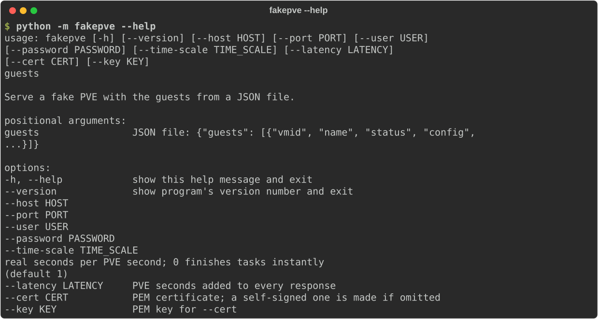
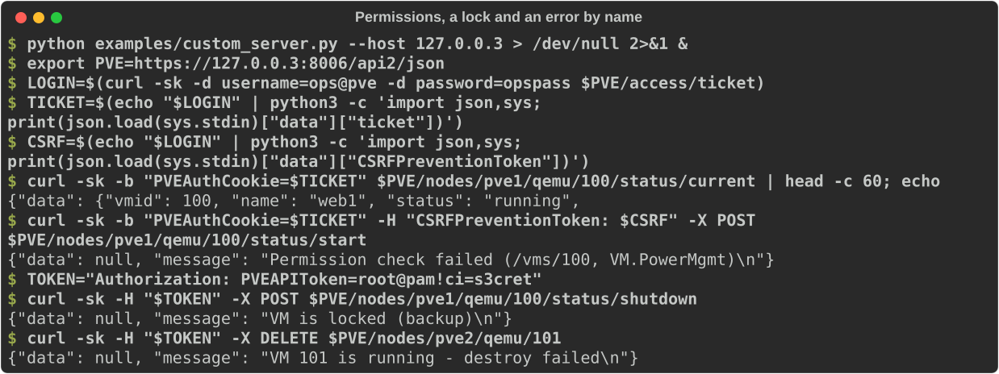

# Command line

`fakepve` (or `python -m fakepve`) serves a fake PVE with the VMs from a JSON file. It is the quickest way to point a client, a Terraform provider or an Ansible playbook at something that behaves like Proxmox. For anything the command line cannot set up, see [what the command line cannot do](#what-the-command-line-cannot-do).

```console
fakepve GUESTS_FILE [--host HOST] [--port PORT] [--user USER] [--password PASSWORD]
                    [--time-scale TIME_SCALE] [--latency LATENCY] [--cert CERT] [--key KEY] [--version]
```



## Options

| Option | Default | Meaning |
|---|---|---|
| `guests` (positional) | required | The JSON file describing the VMs: `{"guests": [...]}`. The fields are listed in [Getting started](getting-started.md#the-guests-file). |
| `--host HOST` | `127.0.0.2` | The address to listen on. Use `0.0.0.0` only in a container, and publish its port on loopback (see [security](#security)). On Linux every `127.x.y.z` address is local, so give each fake its own and keep port 8006. Where only `127.0.0.1` is local (macOS, for one), use that with different ports. |
| `--port PORT` | `8006` | The TCP port. 8006 is PVE's own, and many clients assume it. |
| `--user USER` | `root@pam`, or `$PVE_USER` | The login. Give it with its realm (`user@realm`). This user can do everything unless the fake is used from Python with [grants](scenarios.md#permissions). |
| `--password PASSWORD` | `secret`, or `$PVE_PASS` | Its password. |
| `--time-scale T` | `1` | Real seconds per PVE second. See [time](#time). |
| `--latency SECONDS` | `0` | PVE seconds added to every response (`pve.slow_network(latency)`). Scaled by `--time-scale`, so it does nothing at `0`. |
| `--cert FILE` | none | PEM certificate to serve. Without `--cert` a self-signed one is made, which needs `cryptography`. |
| `--key FILE` | none | PEM key for `--cert`. May be omitted if the key is in the same file. |
| `--version` | | Print the version and exit. |
| `-h`, `--help` | | Show the usage. |

Environment variables: `PVE_USER` and `PVE_PASS` set the defaults of `--user` and `--password`; an option on the command line wins. There are no others.

## Security

fakepve is a test tool, not a security boundary: the login `root@pam` / `secret` is the same for everyone who reads the documentation, and whoever can connect can change the fake's state. Keep it on a loopback address, which is the default. If `--host` is not a loopback address and the password is still the default, it prints a warning to stderr at start-up:

```text
fakepve: WARNING: listening on 0.0.0.0 with the default password "secret", which is public. ...
```

Set `--password` or `PVE_PASS` to silence it, and keep the port off untrusted networks. More in the [security policy](security.md).

## Time

Durations (a shutdown that takes 30 seconds, a latency of 2 seconds) are in PVE seconds, and `--time-scale` turns them into real ones:

| Value | Effect |
|---|---|
| `0` | Every task finishes before its request returns. Fast and deterministic. A `--latency` has no effect. |
| `0.01` | 60 PVE seconds take 0.6 real ones. Tasks show as `running`, hold the VM's config lock, and other requests queue behind them as on PVE. |
| `1` (the default) | Real time. |

## What it prints

One line on stdout when it is ready, and nothing more, apart from the [exposure warning](#security) on stderr when it applies:

```text
fakepve listening on https://127.0.0.2:8006
```

It does not log requests. aiohttp reports errors in a handler on stderr; with a flaky network (a dropped connection is a deliberate error) that produces tracebacks, which can be ignored. Ctrl-C stops it, quietly and with exit status 0.

## Certificates

Without `--cert` the fake makes a self-signed ECDSA certificate (P-256, valid for 30 days, common name `fakepve`, no subject alternative names) in a temporary directory. Clients that check host names will reject it: skip verification, or serve your own certificate. [CI](ci.md#certificates) shows how to make one that also verifies, with `openssl`:

```console
fakepve guests.json --cert fake.crt --key fake.key
```

Without `cryptography` installed, omitting `--cert` ends with `ModuleNotFoundError: No module named 'cryptography'`. Install the `crypto` extra or give `--cert` and `--key`.

## Examples

Real time, with the example guests:

```console
fakepve examples/guests.json
```

Fast tasks and another login:

```console
PVE_USER=admin@pve PVE_PASS=hunter2 fakepve examples/guests.json --time-scale 0
```

Two fakes at once, each on its own address and both on 8006:

```console
fakepve site-a.json --host 127.0.0.2 &
fakepve site-b.json --host 127.0.0.3 &
```

A slow link: every response takes 2 PVE seconds, which is 0.2 real seconds at this scale:

```console
fakepve examples/guests.json --time-scale 0.1 --latency 2
```

## When it fails to start

The command line does no friendly error handling; these are the usual causes and what they look like (the last line of the traceback):

| Cause | Last line |
|---|---|
| The guests file does not exist | `FileNotFoundError: [Errno 2] No such file or directory: 'nope.json'` |
| The file is not valid JSON | `json.decoder.JSONDecodeError: Expecting property name enclosed in double quotes: line 2 column 1 (char 2)` |
| The top level is not an object with `guests` | `TypeError: list indices must be integers or slices, not str` (for a list), or `KeyError: 'guests'` |
| A guest has no `vmid` or `name` | `KeyError: 'vmid'` |
| The address and port are taken | `OSError: [Errno 98] error while attempting to bind on address ('127.0.0.2', 8006): [errno 98] address already in use` |
| No `cryptography` and no `--cert` | `ModuleNotFoundError: No module named 'cryptography'` |

## What the command line cannot do

It builds VMs and sets the login, the time scale and a latency. Everything else is Python: other users and per-path permissions, API tokens, failures (`pve.fail`), locks, backups, migrations, quorum, offline nodes, flaky networks, Ceph, TFA, storage space. For a standalone fake with those, write a small script. [`examples/custom_server.py`](https://github.com/qisback/fakepve/blob/main/examples/custom_server.py) is one: a limited user, a token, a VM in the middle of a backup and a failure by name, served until Ctrl-C.


