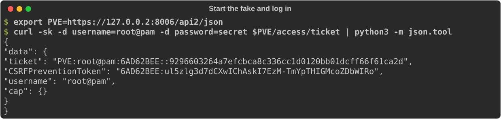
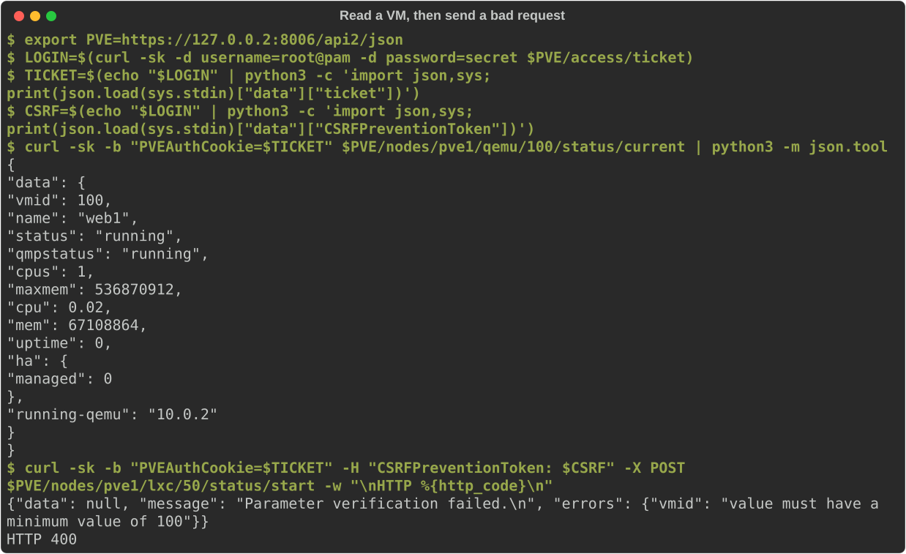
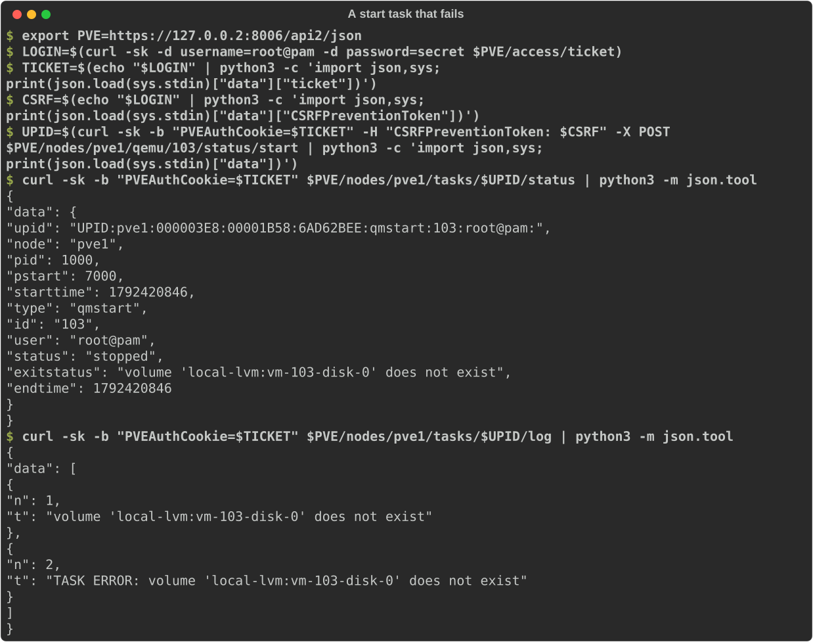

# Getting started

This page takes you from nothing to a client talking to a fake Proxmox VE: install, run the command line tool, send the first requests with curl, then do the same from Python. It ends with the format of the guests file.

Contents: [install](#install) | [run it](#run-it) | [first requests with curl](#first-requests-with-curl) | [API tokens](#api-tokens) | [from Python](#from-python) | [the guests file](#the-guests-file) | [where next](#where-next)

## Install

fakepve needs Python 3.10 or later and aiohttp 3.14.3 or later (the oldest release without a published security advisory). `cryptography` is optional: it makes the self-signed certificate (so the command line needs it unless you bring your own certificate) and the VNC authentication of the console websocket.

From PyPI:

```console
pip install fakepve            # aiohttp only
pip install 'fakepve[crypto]'  # plus cryptography, for the certificate
pip install 'fakepve[pytest]'  # the pytest fixtures (see [pytest](pytest.md))
```

From a checkout:

```console
pip install .            # aiohttp only
pip install '.[crypto]'  # plus cryptography
```

To run it as a container instead, see [CI](ci.md#a-container): `docker run --rm -p 127.0.0.1:8006:8006 ghcr.io/qisback/fakepve`.

This installs the `fakepve` command and the `fakepve` package. `python -m fakepve` does the same as the command, and `fakepve --version` prints the version.

## Run it

```console
python -m fakepve examples/guests.json --host 127.0.0.2
```



It prints one line, `fakepve listening on https://127.0.0.2:8006`, and serves until you press Ctrl-C. The login is `root@pam` with password `secret`; change them with `--user` and `--password`, or the environment variables `PVE_USER` and `PVE_PASS`. All options are in [CLI](cli.md).

Three things to know straight away:

- It is a test tool with a public default login. Keep it on loopback (the default address `127.0.0.2` is), and set a password with `--password` or `PVE_PASS` if anyone else can reach the port. See the [security policy](security.md).
- It serves HTTPS with a self-signed certificate, so clients must skip verification or be given a certificate they trust. See [CI](ci.md#certificates).
- `--time-scale` defaults to `1`, which is real time. A task that PVE would take 30 seconds over takes 30 seconds. For a quick look use `--time-scale 0`, where every task finishes before the request returns.

## First requests with curl

The API lives under `/api2/json`. PVE has three ways to log in; the first two are shown here, tokens are next.

**1. Get a ticket.** Post the user and password to `/access/ticket`. The answer holds a `ticket` (a cookie value) and a `CSRFPreventionToken`.

```console
$ curl -sk -d username=root@pam -d password=secret https://127.0.0.2:8006/api2/json/access/ticket
{"data": {"ticket": "PVE:root@pam:6AD6238B::63586d89...", "CSRFPreventionToken": "6AD6238B:SfJUY3Dk...", "username": "root@pam", "cap": {}}}
```

(Tickets are shortened here; yours are longer and different each time.) A user name without a realm gets `@pam`.

**2. Send the ticket as the `PVEAuthCookie` cookie.** Reads need nothing else:

```console
$ curl -sk -b "PVEAuthCookie=$TICKET" https://127.0.0.2:8006/api2/json/nodes/pve1/qemu/100/status/current
```

**3. Writes also need the CSRF token** in a `CSRFPreventionToken` header. Without it the answer is `401 Permission denied - invalid csrf token`, as on PVE.

```console
$ curl -sk -b "PVEAuthCookie=$TICKET" -H "CSRFPreventionToken: $CSRF" -X POST \
    https://127.0.0.2:8006/api2/json/nodes/pve1/lxc/50/status/start
{"data": null, "message": "Parameter verification failed.\n", "errors": {"vmid": "invalid format - value does not look like a valid VM ID\n"}}
```

That is a real PVE-style validation error: HTTP 400, `data` null, the message, and the per-field `errors`. Here is the whole sequence, with a VM read and the bad request:



Starting a VM returns a task id (a UPID), which you follow through `tasks/{upid}/status` and `tasks/{upid}/log`. VM 103 in the example guests file has a start error, so its task ends with an error:



[`examples/curl.sh`](https://github.com/qisback/fakepve/blob/main/examples/curl.sh) is this walk-through as a script.

## API tokens

PVE's other login is an API token, sent in one header and needing neither a ticket nor a CSRF token:

```console
$ curl -sk -H "Authorization: PVEAPIToken=root@pam!ci=s3cret" https://127.0.0.2:8006/api2/json/version
```

The command line has no option to register tokens. Register them from Python with `pve.apitokens['root@pam!ci'] = 's3cret'`, for instance in a small server script such as [`examples/custom_server.py`](https://github.com/qisback/fakepve/blob/main/examples/custom_server.py). A token has the privileges of its user.

## From Python

In a test you create the fake in the same process and set up exactly what the test needs. This runs as it stands (it is part of the test suite):

<!-- run -->
```python
import ssl
import tempfile

import aiohttp

from fakepve import FakePve, settle
from fakepve.certs import make_cert

certfile, keyfile, _ = make_cert(tempfile.mkdtemp())     # self-signed, needs cryptography

pve = FakePve(user='root@pam', password='secret')        # its own loopback address, port 8006
vm = pve.add_vm(100, 'web1', status='running', config={'scsi0': 'local-lvm:vm-100-disk-0'})
vm.shutdown_secs = 90            # the guest takes 90 PVE seconds to power off: longer than PVE waits
await pve.start(certfile, keyfile)
try:
    ctx = ssl.create_default_context()
    ctx.check_hostname = False
    ctx.verify_mode = ssl.CERT_NONE
    base = 'https://{0}:{1}/api2/json'.format(pve.host, pve.port)
    async with aiohttp.ClientSession(connector=aiohttp.TCPConnector(ssl=ctx)) as session:
        async with session.post(base + '/access/ticket',
                                data={'username': 'root@pam', 'password': 'secret'}) as rsp:
            login = (await rsp.json())['data']
        headers = {'Cookie': 'PVEAuthCookie=' + login['ticket'],
                   'CSRFPreventionToken': login['CSRFPreventionToken']}
        async with session.post(base + '/nodes/pve1/qemu/100/status/shutdown', headers=headers) as rsp:
            upid = (await rsp.json())['data']
        async with session.get(base + '/nodes/pve1/tasks/' + upid + '/status', headers=headers) as rsp:
            task = (await rsp.json())['data']
    print(task['status'], '|', task['exitstatus'])
    print(vm.status)
finally:
    await settle()
    await pve.stop()
```

<!-- output -->
```text
stopped | VM quit/powerdown failed - got timeout
running
```

The shutdown task failed with PVE's own message, and the VM is still running. Everything the fake knows is plain Python you can read and set: `vm.config`, `vm.status`, `vm.lock`, `pve.tasklog`, `pve.requests` (every request seen), and so on. The full list is in the [Python API](python-api.md).

This is the shape of every test: build the cluster, break something, start the fake, drive your client at `https://{pve.host}:{pve.port}`, check the result. The [scenarios](scenarios.md) cover the breaking, and [CI](ci.md) covers pytest fixtures for sync and async clients.

`pve.host` is a loopback address of its own, handed out in turn (`127.0.0.2`, `127.0.0.3`, ...). On Linux the whole of `127.0.0.0/8` is local, so every fake can listen on the usual port 8006. To choose, pass `FakePve(host='127.0.0.1', port=18006)`.

## The guests file

The command line builds its VMs and containers from a JSON file. The top level is an object with a `guests` list, one object per guest:

```json
{"guests": [
  {"vmid": 100, "name": "web1", "status": "running", "shutdown_secs": 30,
   "config": {"boot": "order=scsi0;net0", "scsi0": "local-lvm:vm-100-disk-0,size=8G",
              "net0": "virtio=BC:24:11:00:01:00,bridge=vmbr0"}}
]}
```

[`examples/guests.json`](https://github.com/qisback/fakepve/blob/main/examples/guests.json) has five VMs, one of each interesting kind. These are all the fields the loader reads:

| Field | Type | Default | Meaning |
|---|---|---|---|
| `vmid` | integer | required | The VM id. |
| `name` | string | required | The VM name. It is also put in `config` as `name` if `config` has none. |
| `node` | string | `pve1` | The node the VM lives on. A node that does not exist yet is created, online. |
| `status` | string | `stopped` | `running` or `stopped`. A running VM starts counting its uptime now. |
| `qmpstatus` | string | the `status` | The QEMU state: `running`, `stopped`, `paused`, ... Use `paused` with `status: running` for a suspended VM. |
| `config` | object | `{}` | The VM's config as PVE shows it: `scsi0`, `net0`, `memory`, `boot`, ... Values are strings or numbers, kept as given. |
| `template` | boolean | `false` | A template: it cannot be started, and `/cluster/resources` shows `template: 1`. |
| `lock` | string | none | A PVE lock such as `backup`, `snapshot` or `migrate`. The VM reports it and refuses actions. Unlike `pve.snapshot_lock()` it is not also written into `config`. |
| `acpi` | boolean | `true` | `false`: the guest ignores shutdown and reboot, so they run into the timeout. |
| `shutdown_secs` | number | `0` | PVE seconds the guest takes to power off after a shutdown request. Longer than the request's `timeout` (60 by default) and the task fails. |
| `start_secs` | number | `0` | PVE seconds the start task runs. |
| `stop_secs` | number | `0` | PVE seconds the stop task runs. |
| `start_error` | string | none | The start task fails with this message (a missing disk, a bad device). |
| `ha_state` | string | none | Makes the VM HA managed, with this state (`started`, `stopped`, `error`, ...). Start and stop then go through the HA manager. |
| `agent` | object | none | What the guest agent answers: `{"os": {...}, "interfaces": [...]}`. Without it the agent is not running. |
| `type` | string | `qemu` | `lxc` makes a container instead of a VM. A container takes `vmid`, `name` (its hostname), `node`, `status`, `config`, `template`, `lock`, `shutdown_secs`, `start_secs`, `stop_secs`, `start_error`, `ha_state` and `ostemplate` (a template file name, from which `ostype` and `arch` are worked out). The VM-only fields (`qmpstatus`, `acpi`, `agent`) are ignored. |

Anything else in a guest object is ignored without a warning. Notably there is no `pool` field and no way to set `pending`: use Python for those. A guest without `vmid` or `name` stops the start-up with a `KeyError`. The loader can only set things on VMs; users, grants, tokens, failures and the cluster scenarios are Python only (see [CLI](cli.md#what-the-command-line-cannot-do)).

## Where next

- [CLI](cli.md): every option, with output.
- [Python API](python-api.md): every attribute and method.
- [Scenarios](scenarios.md): slow shutdowns, locks, quorum, Ceph, permissions, failures, one recipe each.
- [Errors](errors.md): PVE's real errors, by name.
- [CI](ci.md): pytest fixtures, background processes, containers and pipelines.
- [How it works](how-it-works.md) and the generated [endpoint reference](reference/endpoints.md).
