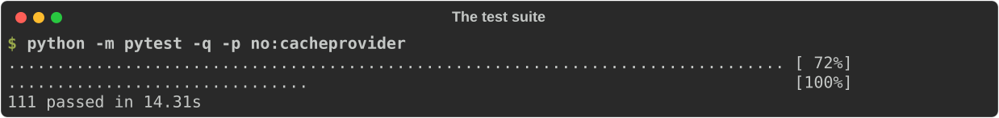

# How it works

A tour of the code for anyone who wants to change fakepve, trust its answers, or refresh it for a new PVE release. For using it, start with [Getting started](getting-started.md).

Contents: [the idea](#the-idea) | [modules](#modules) | [a request's path](#a-requests-path) | [hand-written routes](#hand-written-routes) | [the generic handler](#the-generic-handler) | [validation](#validation) | [permissions](#permissions) | [tasks](#the-task-model) | [locks](#locks) | [errors](#errors) | [known gaps](#known-gaps) | [data files](#data-files) | [refreshing](#refreshing-the-schema-and-the-catalogue) | [tests](#tests) | [documentation tooling](#documentation-tooling)

## The idea

The fake needs to know what a call returns and what it can fail with. It does not reimplement PVE. Two ideas follow:

1. **Outcomes and errors, not behaviour.** The PVE API schema says what every endpoint accepts and answers with; the PVE sources say which errors each one can raise. Both are vendored as data. Most endpoints are answered from the schema alone: a write succeeds and changes nothing, a read returns a value of the right shape.
2. **Behaviour only where a client reads back what it did.** A small set of endpoints (login, VM power, config, tasks, storage, pools, the firewall) is hand-written and keeps state, because a client starts a VM and then asks whether it is running, or creates a pool and reads it back. These override the generic answers.

It stays one Python process on aiohttp. No PVE, QEMU, Ceph or corosync is run, and no PVE code is ported: only strings and the schema are taken from PVE.

## Modules

| Module | Role |
|---|---|
| `fakepve/server.py` | `FakePve`: the aiohttp application, the middleware, and the hand-written routes (access, version, nodes, cluster, tasks, storage, VM status/config/agent/consoles). |
| `fakepve/model.py` | `Model` (the state and the scenario methods) and `FakeVm`; `PveError` and `TaskError`. `FakePve` inherits from `Model`. |
| `fakepve/lxc.py` | `FakeCt` and `LxcApi`, a mixin of `FakePve`: the container state and the stateful `lxc` routes. |
| `fakepve/routing.py` | `StatefulRoutes`: registers the `_routes_*` tables of the modules below, and the helpers they share (PVE's digest check, `die`, `param_error`). |
| `fakepve/storage.py` | `StorageApi`: `/storage`, the node's storage status and the content volumes; `StorageTransfer`: `download-url` and `upload`. |
| `fakepve/pools.py` | `PoolsApi`: `/pools`. |
| `fakepve/firewall.py` | `FirewallApi`: the cluster, node and guest firewall, and the rule check (`verify_rule`). |
| `fakepve/generic.py` | `GenericApi`, a mixin of `FakePve`: the catch-all route, which checks parameters and permissions against the schema and builds answers. |
| `fakepve/schema.py` | The schema: path matching, parameter validation with PVE's wording, sample values for `returns`. |
| `fakepve/errors.py` | The error catalogue: lookup by name, cross-cutting errors, placeholder filling. |
| `fakepve/certs.py` | The self-signed certificate, with `localhost`, `127.0.0.1` and the listening address as subject alternative names. |
| `fakepve/pytest_plugin.py` | The pytest fixtures `fakepve`, `fakepve_session`, `fakepve_url` and `fakepve_cafile`, registered through the `pytest11` entry point. |
| `fakepve/__main__.py` | The command line. |
| `fakepve/data/` | The vendored PVE data: schema and error catalogue. |
| `tools/` | Scripts that refresh the data, generate the reference docs, run the docs' code, take the screenshots, cut releases (`release.py`) and smoke-test the container image (`smoke_image.sh`). |

## A request's path

1. aiohttp matches the path against the hand-written routes, which are registered first. Anything else falls to the catch-all `/api2/json/{tail}` route, which is registered last.
2. The **middleware** (`FakePve._middleware`) wraps every request:
   1. resolves the path against the schema, for the generic handler and for placeholders;
   2. applies the network scenarios, to every client: latency and jitter (global and per node), then a dropped connection (the transport is closed) or a hang (a sleep);
   3. authenticates: an `Authorization: PVEAPIToken=` header, or the `PVEAuthCookie` ticket (checking expiry, and the `CSRFPreventionToken` header on writes). A failed login is answered 401 at once, with the body unread and recorded empty. The login request itself and the few generic endpoints that need no login carry on without a user;
   4. reads the request body (within `pve.body_timeout` and `pve.client_max_size`) and records `(method, path, body)` in `pve.requests`, with secrets redacted;
   5. looks for a matching `pve.fail` rule. A plain rule answers at once with its status and message, or an HTML page. A rule by catalogue name answers with the rendered error, or, if the catalogue says the error happens in a worker, remembers that a task has to fail and goes on;
   6. returns 595 if the path's node is offline;
   7. runs the handler, or, for a pending task failure, starts the task that fails.
3. A `PveError` from anywhere becomes the response: the status, the first line of the message as the reason phrase, and `{"data": null, "message": "...\n"}` plus `errors` for a 400. Any other exception becomes `500 internal error`; it is logged by the `fakepve` logger, and the client sees no traceback.

### The ExtJS format

Every route is also served under `/api2/extjs`, with the same handlers, authentication and scenarios (`pve.fail`, network trouble, offline nodes). Only the envelope differs, as in PVE's web UI formatter: the HTTP status is always 200, the body has `data` and `success` (`1`, or `0` when there is an error or per-field `errors`), and for an error the status and message move into the body:

```json
{"data": null, "message": "Parameter verification failed.\n", "status": 400, "success": 0, "errors": {"vmid": "..."}}
```

`pve.requests` records the path as it was sent, so a test can tell the two formats apart. The `htmljs` form (file upload forms) and the other PVE formats are not served.

## Hand-written routes

`FakePve._build_app` lists them. They are the paths whose answers depend on what happened before:

- `access/ticket`, `access/password`, `version`;
- `nodes`, `cluster/resources`, `cluster/status`, `cluster/ceph/status`, `cluster/nextid` (VM and container ids);
- per node: `tasks`, `tasks/{upid}/status`, `tasks/{upid}/log`, `storage/{s}/download-url`, `storage/{s}/upload`;
- per VM: `status/current`, `status/{start,stop,shutdown,reboot,reset,suspend,resume}`, `config` (GET, PUT, and POST as a task), `pending`, `termproxy`, `vncproxy`, `vncwebsocket`, `agent/{command}` (every command in the schema), `monitor`;
- per container (`lxc.py`): the list and create, destroy, `status/current`, `status/{start,stop,shutdown,reboot,suspend,resume}`, `config` (GET and PUT), `pending`, `clone`, `template`, `migrate` (GET and POST), `resize`, `interfaces`, `snapshot` (list, create, delete, `rollback`, and each snapshot's `config`).

They follow PVE's rules: config writes on a running VM go to `pending` unless the key is hot-pluggable; a CD-ROM media change applies at once; `reboot` and a cold start apply pending changes and `reset` does not; `PUT config` checks the `digest`, validates the boot order against the VM's devices, and checks the privilege each key needs (`hookscript` is root only); starting a running VM, or acting on a stopped one, gets PVE's messages; templates cannot be started.

One route family is claimed as a whole, so it hides generic answers: `status/{action}` (an action without a `_do_` handler answers 501). `agent/{command}` is claimed too, but every command of the schema is answered there (see `agent.py`). The [endpoint reference](reference/endpoints.md) marks the methods affected as "routed to a hand-written handler that answers 501". The storage, pool and firewall endpoints are listed in [the next section](#storage-pools-and-the-firewall). The container routes are registered one by one, and each runs the schema's checks first (`answer`), so a request fails for the same reasons whether or not the container exists. The rest of the LXC endpoints are generic (see the gaps below); a container's firewall is served by `firewall.py`.

### Storage, pools and the firewall

These three areas live in their own modules and are registered from tables (`StatefulRoutes`): each lists `(method, schema path, handler)`, and the request goes through the same schema checks as a generic one (parameters, permissions, the node must exist) before the handler runs, so a handler only deals with PVE's own rules. They follow the PVE sources, not the schema alone:

- **Storage** (`pve-storage`: `API2/Storage/Config.pm`, `Status.pm`, `Content.pm`, and each plugin's `options()` and `plugindata()`). `pve.storages` is the storage.cfg: the keys outside `files`, `avail`, `active`, `volumes` and `total` are options. Create, update and delete use the type's option table (required options, fixed ones, unexpected ones, `content` cut to what the type supports, `path` defaulting to `/mnt/pve/<id>` for NFS, CIFS and CephFS), the digest of the whole file, and PVE's error text with `create storage failed: `, `update storage failed: ` and `delete storage failed: ` where PVE adds them. Node status asks the same questions as `storage_info`: `disable`, a `nodes` list, `content`, `target`. Volumes are kept per storage (`pve.storages[name]['volumes']`) and named as the plugin names them (`100/vm-100-disk-0.qcow2` on file storages, `vm-100-disk-0` on block ones).
- **Pools** (`pve-manager`: `API2/Pool.pm`). `pve.pools` maps a pool to the ids of its guests (VMs and containers), `pve.pool_info` has the comment and the storages. An update is applied to a copy and kept only if every member change passes, as PVE writes `user.cfg` once at the end.
- **Firewall** (`pve-firewall`: `API2/Firewall/*.pm`, `Firewall.pm`). Cluster, node and guest each hold options, rules, aliases and IP sets; the cluster also holds the security groups. A guest's config is kept by its id whatever it is (PVE does not look for the guest either), so `qemu` and `lxc` paths read the same rules. Digests are PVE's: SHA-1 over `key:value` lines of each entry, sorted by key. Rules go on top when created and start disabled unless `enable` is given; `moveto` puts the rule in front of the one that was at that position.

## The generic handler

`GenericApi.answer` handles every other request, in this order:

1. 404 if the path is not in the schema, 501 if the path is but the method is not.
2. **Validate** the parameters (path parameters included) against the method's schema. Errors give 400 with a per-field `errors` object.
3. 500 `hostname lookup ... failed` if the path names a node the model does not know.
4. **Check permissions** against `pve.grant`.
5. **Synthesise** the answer: a task if the method starts one, else a value built from `returns`.

### Synthesising answers

`schema.sample` builds a value from a `returns` schema: required properties are filled, optional ones only where the name says what to put (`node`, `vmid`, `storage`), lists have one item, numbers are their minimum or default, strings come from the `format` (a node name, a storage id, an IP address) or from a string that matches the `pattern`. Values come from the request path and the model where they can. A method with a `links` directory listing returns one entry per child path.

A method starts a task when it `returns` a string, is `protected`, and its description mentions a task or UPID (`schema.is_task`); `NOT_TASKS` in `generic.py` lists the exceptions. The task is real: it has a UPID, shows in `tasks`, and finishes `OK`. Its type is the last segment of the path (`start`, `vmid`, ...), not PVE's own (`qmstart`), unlike the hand-written and by-name-failed tasks.

## Validation

`schema.validate` checks, with PVE's wording: missing properties, properties the schema does not define (when it forbids extras), enums, types (booleans take 0/1, true/false, yes/no, on/off), minimum and maximum, string length and patterns, `requires` dependencies, and array item counts, and the `format` of a parameter ([formats](#formats)). Regular expressions that only Perl understands are skipped. Values come from the query string, a form body or a JSON body.

### Formats

A parameter with a `format` is checked the way `PVE::JSONSchema` checks it: after the type, before the pattern, the length limits, the range and the enumeration. A failure reads `invalid format - <PVE's message>` with PVE's trailing newline, under the parameter's name. Any name may carry PVE's `-list` suffix (items separated by commas, semicolons or white space, or NUL) or `-opt` (an empty value passes). Matching is linear, and a value over 4096 characters is refused before any check (PVE has no such limit).

**Property strings** (`net0=virtio,bridge=vmbr0`) are parsed as PVE parses them: `key=value` pairs, a bare first value for the `default_key`, aliases (`virtio=BC:24:11:00:00:01` sets `model` and `macaddr`), booleans as `1`/`0`/`yes`/`no`/`on`/`off`/`true`/`false`. Each key is checked against its sub-schema, so a bad value, a missing required key, a key whose `requires` partner is missing and an unknown key are all reported. A syntax problem is a single message (`invalid key in comma-separated list property: bogus`); the other problems come as `format error` followed by one `param.key: message` line each. Numbered parameters (`net0`, `scsi3`, `ipconfig1`, `mp5`) use the schema of their pattern (`net[n]`, ...) within the limits PVE sets (`net` and `ipconfig` up to 31, `ide` 3, `sata` 5, `scsi` 30, `virtio` 15, `unused` and `mp` 255, and so on); a number past the limit is not a parameter of the method. The schema spells most property strings out inline; for the ones it only names, fakepve carries PVE's sub-schemas: `pve-qm-ipconfig`, `pve-qm-boot`, `pve-qm-rng`, `pve-qm-watchdog`, and `pve-qm-ide` (the `cdrom` drive, taken from `ide[n]`).

**Named formats checked** (42): `CIDR`, `CIDRv4`, `CIDRv6`, `IPorCIDR`, `IPorCIDRorAlias`, `address`, `disk-size`, `dns-name`, `email`, `email-or-username`, `ip`, `ipv4`, `ipv4mask`, `ipv6`, `ldap-simple-attr`, `mac-addr`, `pve-bridge-id`, `pve-configid`, `pve-fw-comment-spec`, `pve-groupid`, `pve-hotplug-features`, `pve-iface`, `pve-ipv4-config`, `pve-ipv6-config`, `pve-node`, `pve-poolid`, `pve-realm`, `pve-roleid`, `pve-startup-order`, `pve-storage-content`, `pve-storage-id`, `pve-storage-path`, `pve-storage-server`, `pve-tag`, `pve-tokenid`, `pve-userid`, `pve-vlan-id-or-range`, `pve-vmid`, `pve-volume-id`, `pve-volume-id-or-absolute-path`, `pve-volume-id-or-qm-path`, `urlencoded`.

**Named formats accepted without checking** (57): `FullRangeCIDR`, `backup-fleecing`, `backup-performance`, `bridge-pair`, `graphite-path`, `lxc-ip-with-ll-iface`, `mac-prefix`, `pem-certificate-chain`, `pem-string`, `proxmox-remote`, `prune-backups`, `pve-acme-alias`, `pve-acme-domain`, `pve-calendar-event`, `pve-command-batch`, `pve-cpuset`, `pve-ct-timezone`, `pve-day-of-week`, `pve-dir-override`, `pve-fw-addr-spec`, `pve-fw-conntrack-helper`, `pve-fw-dport-spec`, `pve-fw-icmp-type-spec`, `pve-fw-protocol-spec`, `pve-fw-sport-spec`, `pve-ha-node`, `pve-ha-resource-or-vm-id`, `pve-lxc-dev-string`, `pve-lxc-mp-string`, `pve-node-location`, `pve-phys-bits`, `pve-priv`, `pve-qemu-sev-fmt`, `pve-qemu-tdx-fmt`, `pve-qm-bootdisk`, `pve-qm-cicustom`, `pve-qm-hostpci`, `pve-qm-smbios1`, `pve-replication-job-id`, `pve-sdn-bgp-rt`, `pve-sdn-dhcp-range`, `pve-sdn-fabric-id`, `pve-sdn-fabric-wireguard-interface`, `pve-sdn-isis-net`, `pve-sdn-prefix-list-id`, `pve-sdn-route-map-id`, `pve-sdn-subnet-id`, `pve-storage-options`, `pve-storage-path-in-property-string`, `pve-storage-portal-dns`, `pve-storage-vgname`, `pve-storage-zfs-blocksize`, `pve-task-status-type`, `pve-tfa-config`, `pve-vm-cpu-conf`, `realm-sync-options`, `storage-pair`. A value for one of these is only checked for its type, pattern and length. Their rules need the rest of PVE (storage and network configuration, the firewall rule language, calendar events, CPU models), or are property strings that the schema only names. The `IPorCIDR` formats answer one message for every failure, where PVE passes on the text of its IP library.

`PUT` and `POST` on a VM's `config` run the same checks, so `PUT config` with `net0=virtio,bogus=1` or `delete=0bad` is a 400, as on PVE.

## Permissions

`pve.acl` is `None` until the first `grant()`, and everyone is allowed everything. After that only `root@pam` (or a token of it) is exempt, and `allowed(user, path, priv)` looks for a grant on the path or any parent, including pool paths for VMs.

The generic handler evaluates the schema's `permissions` field: `perm` with a path template, privileges and the options `any`, `require_param`; `and` and `or`; `userid-param`; `userid-group` (approximated as the privileges on `/access/groups`, since there is no group model); `perm-modify`; and `user: all` or `world`. `{param}` in a path is filled from the request. A method with no permissions in the schema, or a rule of a form not known here, is root only. The 403 reads `Permission check failed (/vms/100, VM.PowerMgmt)`.

## The task model

`Model.task(node, ttype, tid, user, body, vm=None, lock=True, log=())`:

1. makes a UPID, `UPID:<node>:<pid hex>:<pstart hex>:<start hex>:<type>:<id>:<user>:`, and a record that is stored in `pve.tasks` and `pve.tasklog`;
2. at `time_scale` 0 runs the task to the end before returning; otherwise schedules it on the event loop and returns the UPID at once;
3. the task takes the VM's config lock first (waiting `lock_wait` PVE seconds for another holder), runs `body()`, and releases it;
4. `body` may return a string, which is logged, and raises `TaskError` to fail;
5. at the end the record gets `status: stopped`, `exitstatus` (`OK` or the message), `endtime`, and the log gets `TASK OK` or `TASK ERROR: message`.

Everything that takes time (`vm.shutdown_secs`, `start_secs`, `pve.backup`, Ceph slowness) goes through `pause`, which scales it. That is the only reason one switch, `time_scale`, covers all of it.

## Locks

There are two, as on PVE. The **lock field** (`vm.lock`: `backup`, `migrate`, `snapshot`, ...) is visible in the config and `status/current`, and start, shutdown, reboot and config writes check it and answer `VM is locked (backup)`. The **config lock** (`vm.lock_holder`) is PVE's lock file: tasks and config writes take it and wait for it, and `hold_config_lock` takes it on behalf of a pretend worker. Waiting for a held lock times out after `lock_wait` PVE seconds with `can't lock file '/var/lock/qemu-server/lock-N.conf' - got timeout`. At `time_scale` 0 nothing waits, so a held config lock fails at once.

## Errors

Handlers raise `PveError(status, message, errors)`. Named errors come from `errors.py`: `listing(method, path)` is the catalogue's entries for the method plus the cross-cutting ones, `render` fills the placeholders, and the middleware turns the result into a response, or into a failing task for entries marked `in_task` ([Errors](errors.md)).

## Known gaps

Stated plainly, so nobody has to find them by surprise:

- **Most of the API keeps no state.** Outside the hand-written routes a write succeeds and changes nothing, and a read returns a made-up value of the right shape. Create a VM through `POST /nodes/pve1/qemu` and it does not exist afterwards; add VMs with `pve.add_vm` or the guests file.
- **Storage is configuration and metadata.** Nothing is mounted or connected (a storage is never "not online" unless a scenario says so), volumes are records with a size, and a disk image takes `size` bytes from `avail` but holds no data. Plugin checks beyond the option tables (a reachable NFS server, an existing volume group, the `mkdir` warnings) are not made. Only the file storages (`dir`, `nfs`, `cifs`, `cephfs`, `btrfs`) and the common block ones (`lvm`, `lvmthin`, `zfspool`, `rbd`, `zfs`, `iscsi`, `pbs`) have an option table; other types are accepted with any option.
- **The firewall is configuration only.** Nothing is enforced, `log` is empty, and macros are checked by name, not applied. The protocol and service names a rule can use are a sample of `/etc/protocols` and `/etc/services` (PVE reads the whole files), and the Net::IP text of an invalid address is replaced by a short message. SDN VNet firewalls and IP sets are not modelled.
- **Pool permission failures read differently.** PVE raises them inside its user.cfg lock, so they come back as `500 update pools failed: Permission check failed (...)`, which the fake repeats.
- **Containers are modelled in part.** Create, destroy, power state, config with pending and hotplug rules, snapshots, clone, template, migrate, resize and interfaces keep state (`lxc.py`). A container's `rootfs` and mount points are listed as volumes in the storage content (type `rootdir`, with their owner and size), but they are not counted in the storage's `used` and `avail`. An OS template is looked for only on a storage that lists templates of that kind (`pve.volume_exists`, which tests can replace). `restore` creates an empty container. `move_volume`, `remote_migrate`, `feature`, the console endpoints and `rrd` stay generic (the firewall is `firewall.py`'s); `ssh-public-keys` and `password` are accepted and dropped; a live (`online`) migration fails in its task, as PVE's does. Hotplug of a new mount point, a network change or a memory limit always succeeds: PVE's runtime failures (cgroup, veth) are not simulated.
- **Some messages are approximations.** Two texts could not be settled from the PVE sources. The Net::IP part of `invalid IP address: ...` in the firewall is a short message of the fake's own, because Net::IP's error text is not in the sources (`Firewall.pm` only adds its prefix). `unable to write to storage '...': No space left on device`, for a volume allocation or an upload that does not fit in `avail`, is the fake's wording too: `pve-storage` has no such text (a directory storage creates sparse files, and `qemu-img` and `lvcreate` print their own errors). The other messages of storage, pools, firewall and containers were checked against `pve-storage`, `pve-container`, `pve-common`, `pve-access-control` and `pve-firewall`.
- **Guest agent commands are shapes, not behaviour.** `ping`, `get-osinfo` and `network-get-interfaces` read `vm.agent`, and `fsfreeze-*` keep a frozen flag. The rest answer plausible values, and `exec`, `exec-status`, `file-read` and `file-write` only record the request: nothing runs and no file is touched. `shutdown` and `suspend-*` do not change the VM.
- **Two-factor logins stop at `NeedTFA`.** There is no second step to complete.
- **Some formats are accepted without checking.** Property strings and the common named formats are validated ([formats](#formats)); the rest are listed there, and so are regular expressions that only Perl understands.
- **Generic tasks have a simple type.** A task started by a generic method is named after the last path segment (`start`, `vmid`), not PVE's (`qmstart`, `qmdestroy`). Tasks of the hand-written routes and of failures by name use PVE's names.
- **Ceph changes are detected on existing disks.** `ceph_down` fails a config change to a disk that is already on RBD; adding a new RBD disk to a VM goes through.
- **`pve.latency` does nothing.** Use `slow_network()`.
- **The guests file** cannot set a pool, pending changes or anything but the fields in [Getting started](getting-started.md#the-guests-file).
- **The error catalogue is an approximation**, with its own list of limits in [Errors](errors.md#limits-and-approximations).

## Data files

`src/fakepve/data/` holds:

- `pve-api.json.gz`: the PVE API viewer's `apidoc.js`, trimmed to what answering needs (parameters, returns, permissions, `protected`, `allowtoken`; the prose is dropped except the `returns` description, which is how task methods are recognised), as `{"paths": {template: {METHOD: info}}}`.
- `pve-api.meta.json`: its source, date, SHA-256, and the counts.
- `pve-errors.json.gz`: `{"meta": ..., "errors": {"METHOD template": [entry, ...]}}`. The entry fields are in [Errors](errors.md).

Both are derived from Proxmox VE, which is AGPL-3.0, and are distributed under the same terms (see the licence section of the README).

## Refreshing the schema and the catalogue

A weekly GitHub workflow (`.github/workflows/schema-check.yml`) runs `python tools/check_schema.py`, which hashes the online `apidoc.js` and compares it with the `sha256` in `pve-api.meta.json` (exit 0 same, 1 changed, 2 unreadable). When it differs, the workflow opens an issue, once per new hash. You can run the tool by hand.

For a new PVE release:

1. **Schema.** `python tools/fetch_schema.py [URL_OR_FILE]` downloads the API viewer's `apidoc.js` (the default is `https://pve.proxmox.com/pve-docs/api-viewer/apidoc.js`), trims it, and writes `pve-api.json.gz` and `pve-api.meta.json`.
2. **Error catalogue.** Clone the twelve PVE repositories (listed in [Errors](errors.md#regenerating-the-catalogue)) into one directory and run `python3 tools/extract_errors.py /path/to/clones`. It writes `pve-errors.json.gz` and prints the counts and the source methods it could not map. It reads the code with a small Perl tokenizer; it does not run it.
3. **Version.** Update `Model.version` and `Model.release_version` in `model.py` if the answer of `/version` should follow.
4. **Tests.** Run the test suite. The coverage test sends a valid request to every method in the schema and checks the answer against its `returns`; the catalogue tests check names, placeholders and triggering.
5. **Docs.** Regenerate the derived documentation (below) and commit it with the data: the endpoint reference and the signature index change with the schema, and the output blocks in [Scenarios](scenarios.md) may change with the catalogue.

## Checking against a real PVE

`tools/compare_real.py` (standard library and aiohttp only) finds where the fake's answers differ in shape from a real PVE's. It is read-only: the client has one request method and refuses anything but `GET` before a request is built.

1. **Record.** Create an API token for a user with the `PVEAuditor` role (privilege separation off, or the role on the token as well) and put `user@realm!id=secret` in a file. Then run:

   ```text
   python tools/compare_real.py record --url https://pve.example.org:8006 --token-file ~/pve.token --cafile ca.pem --out shape.json
   ```

   Use `--insecure` instead of `--cafile` for a self-signed certificate. The token is read from the file only; it is not an argument, is never printed or logged, and the tool refuses to write a file that contains it. The walk takes every `GET` method of the schema, finds real values for path parameters through the list endpoints (`/nodes`, `/nodes/{node}/qemu`, `/storage`, `/pools`, ...), and sends at most `--per-param` (2) requests per method and `--max-requests` (1500) in all, `--concurrency` (4) at a time, each within `--timeout` seconds. It does not send the console and websocket methods (`vncproxy`, `termproxy`, `spiceproxy`, `vncwebsocket`), downloads (`aplinfo`, `file-restore`), network scans and URL probes, the guest agent, `report`, methods with required query parameters, or `rrd` and `rrddata` (add `--include-rrd`). The skips are listed in the output and in the file.

2. **Keep only shapes.** The shape file holds, per method, the HTTP status, the types of the answer and its key names, and the text of any error with every word the schema does not know, every name and every number replaced by `<x>`. Keys the schema does not name (a VM name used as a key) become `<key>`. There are no names, addresses, identifiers or paths, and a self-check rejects a file where a string value, an unknown key or an unexpected field would get in. The file also holds counts of nodes, VMs, containers, storages and pools, to seed the fake.

3. **Diff.** `python tools/compare_real.py diff shape.json` starts a fake in-process with those counts (it needs the `crypto` extra), records it the same way and lists, per method, status differences, keys missing from the fake, extra keys and type differences. `--against other.json` compares two shape files instead. The exit status is 0 unless `--strict` is given and a difference was found. `python tools/compare_real.py --self-test` records a fake and diffs it against itself.

Limits: only reads are covered, so writes, tasks and most error paths need a disposable PVE (a later phase). A token with a narrow role gets `403` for some methods, which shows as a status difference. Keys the real PVE returns but the schema does not document are folded into `<key>`, so they do not show as missing keys.

## Tests

`tests/` holds, besides the unit tests of the fake:

- `test_schema_api.py`: every method of the schema answers, and the answer matches `returns`; validation and permission behaviour of the generic handler.
- `test_error_catalogue.py`: the catalogue, `errors_for`, triggering by name, in-task errors.
- `test_scenarios.py` and `test_smoke.py`: the stateful behaviour and the scenarios.
- `test_compare_real.py`: the comparison tool (above): sanitiser, GET-only guard, token handling, skip list, diff.
- `test_docs.py`: the documentation (below). `test_examples.py`: the examples run.

Lint with `ruff check .` and run `pytest` from the repository root, with `src` on the path (`PYTHONPATH=src`) when the package is not installed.



## Documentation tooling

The documentation is kept honest by code:

- `tools/gen_docs.py` generates `docs/reference/endpoints.md` (from the schema, the catalogue and the registered routes) and the signature index at the end of `docs/python-api.md` (from the code). `python tools/gen_docs.py` rewrites them; `--check` reports whether they are stale. A test runs the check.
- `tools/docs_runner.py` runs the code blocks in the docs. A `python` fence after a `<!-- run -->` line is executed (top-level `await` works, and the blocks of one file share a namespace). A `text` fence after a `<!-- output -->` line must equal what the block printed. `python tools/docs_runner.py --fill` rewrites the output blocks from a real run.
- `tools/screenshots.py` runs real commands against a running fake and renders them as SVG terminal images in `docs/img`. It needs `rich` (`pip install rich`), which is not a dependency of fakepve.
- `tests/test_docs.py` checks the relative links, the generated files, the run blocks, and that no page uses an em dash or en dash.
